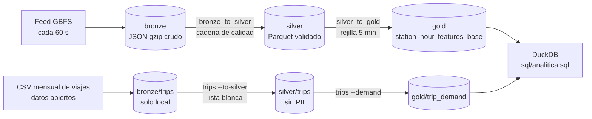

# Data lake de Radar ECOBICI CDMX

Arquitectura **medallion** en tres capas. Todo vive en `data/` (ignorado por git) en formato
local, y se replica capa por capa a SeaweedFS (S3 local, D-009) con
`uv run python scripts/sync_lake.py --layer bronze|silver|gold --check-idempotent --json`.
Todos los tiempos del lake están en UTC. La hora local `America/Mexico_City` aparece solo en
features y reportes.

| Capa | Formato | Quién escribe | Reprocesar |
|---|---|---|---|
| Bronze | JSON gzip tal como llegó del feed; CSV de viajes | recolector / `bronze-writer` / `trips --download` | nunca: append-only |
| Silver | Parquet tipado (zstd) + `_manifest.json` | `radar.lake.bronze_to_silver`, `radar.lake.trips --to-silver` | reemplaza la partición completa |
| Gold | Parquet de agregados y features + `_manifest.json` | `radar.lake.silver_to_gold`, `radar.lake.trips --demand` | reemplaza la partición completa |

## Bronze

- `bronze/station_status/dt=YYYY-MM-DD/hour=HH/station_status_<last_updated>.json.gz`: un archivo
  por snapshot del feed (60 por hora). `dt`/`hour` salen del `last_updated` del feed, no del reloj.
- `bronze/station_information/dt=YYYY-MM-DD/station_information_<sha8>.json.gz`: una versión
  nueva solo cuando cambia el sha256 del JSON canónico de las estaciones.
- `bronze/heartbeat/dt=YYYY-MM-DD.jsonl`: una línea por corrida del recolector.
- `bronze/trips/public_data_web_AAAA-MM.csv`: CSV mensual de viajes (~103 MB, 1,599,384 viajes
  en octubre de 2026). **Nunca sale de la máquina** (ver Seguridad).

Reglas: escritura atómica (temporal + `fsync` + `os.replace`); si el destino existe no se toca;
ningún código borra ni reescribe bronze. Guardar primero y validar después (D-006): si la
validación tiene un error, bronze permite reprocesar.

## Silver

| Tabla | Partición | Contenido |
|---|---|---|
| `silver/station_status` | `dt=/hour=` | una fila por `(station_id, last_reported)`, tipada, con `capacity` |
| `silver/quarantine` | `dt=/hour=` | filas rechazadas, como texto, con `motivo` |
| `silver/station_information` | sin partición | versión más reciente, con `short_name_norm` e `info_hash` |
| `silver/trips` | `month=AAAA-MM` | 6 columnas de la lista blanca, fechas en UTC |

**Cadena de calidad** (Chain of Responsibility, `radar.lake.quality`): `SchemaCheck` → 
`KnownStationCheck` → `CapacityRuleCheck` → `DedupCheck`. Cada eslabón separa lo que falla
(cuarentena con su motivo) y pasa el resto. La regla de capacidad es
`bicis + bicis dañadas + muelles + muelles dañados == capacity`. Los duplicados (minutos sin
cambios) se cuentan, pero no van a cuarentena.

Resultados reales, 6 horas del 9 y 10 de noviembre de 2026:
- La regla de capacidad se cumple entre el 99.70 % y el 99.78 % de las veces.
- Toda la cuarentena (580 filas) es por `regla_capacidad`, siempre en las mismas 11 estaciones y siempre por ±1.
- Cerca del 75 % de las filas leídas son duplicados que se descartan.

**Viajes** (`radar.lake.trips --to-silver`):
- Lee solo `Ciclo_Estacion_Retiro`, `Fecha_Retiro`, `Hora_Retiro`, `Ciclo_EstacionArribo`, `Fecha_Arribo` y `Hora_Arribo`. Pasa `dd/mm/yyyy HH:MM:SS` de `America/Mexico_City` a UTC.
- La partición es el mes del archivo. El CSV agrupa los viajes por fecha de llegada: el de octubre trae 147 viajes que salieron en septiembre o antes, uno de ellos en febrero.
- Octubre de 2026: 1,599,384 filas leídas, 0 descartadas. El archivo es UTF-8 con BOM.
- El Parquet pesa 16 MB contra 103 MB del CSV.

**Idempotencia:** cada job escribe en `<partición>.tmp/`, intercambia la carpeta y deja un
`_manifest.json` con llaves ordenadas y **sin marcas de tiempo**, que incluye el sha256 del
Parquet. Si dos corridas dan el mismo manifiesto, reprocesar no cambió nada
(`--check-idempotent`).

## Gold

| Tabla | Partición | Columnas |
|---|---|---|
| `gold/features_base` | `dt=` (día UTC) | `station_id`, `ts_utc` (rejilla de 5 min), `bikes_available`, `docks_available`, `capacity`, `is_renting` |
| `gold/station_hour` | `dt=` (día UTC) | `station_id`, `hora_utc`, `bikes_mean/min/max`, `docks_mean`, `n_obs`, `pct_vacia`, `pct_llena` |
| `gold/trip_demand` | sin partición | `short_name_norm`, `dow` (0 = lunes), `hour_local`, `salidas_prom`, `llegadas_prom`, `tasa_match` |

- **Rejilla de 5 minutos.** Silver guarda un renglón por *cambio* de estado. Para cada punto de
  la rejilla se toma el último reporte con `snapshot <= punto`, es decir, el último valor
  conocido. Es un join "as-of" hacia atrás, sin mirar al futuro. La rejilla solo cubre las horas
  que tienen silver: no se rellenan huecos del recolector.
- **`station_hour` se calcula sobre la rejilla, no sobre silver.** Así una estación que no
  cambió en toda la hora pesa igual que una que cambió 30 veces: es un promedio ponderado por
  tiempo. `n_obs` cuenta los reportes distintos de la hora y mide cuánto movimiento tuvo la
  estación.
- **`trip_demand`.**
  - Promedia cada día de la semana entre las fechas que ese día tiene en el mes (octubre de 2026 tiene 5 jueves). No divide entre los días que tuvieron viajes.
  - Las salidas o llegadas con fecha local fuera de los meses del archivo no cuentan.
  - `tasa_match` es el porcentaje de extremos de viaje cuyo código existe en `station_information.short_name_norm`. Con los datos reales es **1.0**: los 676 códigos de octubre, incluidos 62,069 viajes desde estaciones compuestas como `266-267`, existen tal cual en el feed.

**Reporte SQL** (`docs/reportes/analitica.md`, desde `sql/analitica.sql`, DuckDB sobre el Parquet):

| Consulta | Técnica SQL | Hallazgo (6 horas de feed + octubre de viajes) |
|---|---|---|
| `estaciones_que_mas_se_vacian` | `JOIN` gold ↔ station_information | 20 estaciones estuvieron vacías el 100 % del tiempo observado |
| `patron_por_dia_y_hora_local` | `GROUP BY … HAVING COUNT(*) >= 30` | el lunes 9 de noviembre, las estaciones vacías pasaron del 13.6 % (14 h) al 31.6 % (19 h) |
| `estaciones_sobre_el_promedio` | subconsulta `IN (SELECT …)` | las estaciones compuestas de Buenavista (`237-238`, `266-267`, `273-274`) concentran más bicis |
| `ranking_de_actividad_por_hora` | ventana `RANK() OVER (PARTITION BY …)` | `271-272` y `292` son las más activas en casi todas las horas |
| `cuarentena_por_motivo` | agregación | 580 filas, todas `regla_capacidad`, de 11 estaciones |
| `demanda_historica_hora_pico` | `JOIN` por `short_name_norm` | `266-267` promedia 66 salidas a las 7 h en día hábil y solo 6.6 llegadas |

**Benchmark DuckDB vs pandas** (`docs/reportes/benchmark_duckdb_pandas.md`):
- Misma agregación (viajes y duración media por estación, día y hora local) sobre 1.6 M viajes.
- Cada motor corre en su propio subproceso, 3 veces.
- Ambos motores dieron exactamente los mismos 89,063 grupos.

| Fuente | DuckDB s | pandas s | DuckDB MB de trabajo | pandas MB de trabajo |
|---|---|---|---|---|
| Parquet silver | 0.47 | 0.59 | 58 | 249 |
| CSV bronze | 0.56 | 9.8 | 165 | 356 |

Sobre Parquet los dos son rápidos, porque las columnas ya vienen tipadas. pandas usa 4 veces más
memoria porque materializa todo el DataFrame. Sobre CSV, pandas tarda 17.5 veces más: interpreta
1.6 M fechas en texto. DuckDB lee el CSV en paralelo y en streaming. Conclusión: convertir a
Parquet una sola vez (silver) es lo que más ayuda. Sobre ese Parquet, DuckDB conviene para la
analítica y pandas basta para las features del modelo.

## Seguridad

- **Identidades separadas en SeaweedFS:**
  - `admin` solo crea buckets (`lake_setup.py buckets`).
  - `radar-app` solo tiene `Read`, `Write` y `List` sobre `radar-bronze`, `radar-silver` y `radar-gold`.
  - `lake_setup.py check-policy` comprueba que `radar-app` reciba `AccessDenied` al crear o borrar buckets. La prueba deja un objeto dentro del bucket, así que una política mal escrita daría `BucketNotEmpty` y no borraría nada.
- **Secretos:** las llaves viven en `.env` y en `docker/seaweedfs/s3.json`, que se genera con
  `lake_setup.py render` y está ignorado por git. `.env.example` solo trae nombres vacíos.
- **PII de viajes:**
  - El CSV trae `Genero_Usuario`, `Edad_Usuario` y `Bici`. Vive solo en `data/bronze/trips/` local.
  - `radar.lake.store.layer_files` excluye `bronze/trips/` en código, sin un flag que lo desactive. `sync_lake.py` reporta `claves_trips: 0`.
  - Silver usa una **lista blanca** de columnas, no una lista negra: si el CSV agrega una columna nueva (por ejemplo, un apellido), no se cuela. Hay una prueba que lo verifica.
  - Gold solo tiene agregados por estación, día de la semana y hora.
- **Costo:** todo corre local y sin costo. Ningún paso del lake usa AWS ni servicios administrados.
