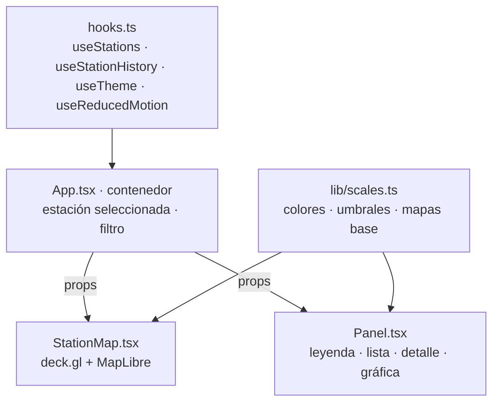

# Manual del frontend (mapa 3D)

Mapa 3D de las ~677 estaciones de ECOBICI: una columna por estación cuya **altura** son las bicis
disponibles y cuyo **color** es la tendencia predicha a 60 minutos. Panel lateral con leyenda,
buscador, detalle de la estación y su historia de 6 horas. Tema verde claro/oscuro.

| | |
|---|---|
| Stack | React 19 + Vite 8 + TypeScript 5.9 (estricto) · deck.gl 9.4 (`ColumnLayer`) · MapLibre 6 vía `react-map-gl/maplibre` · mapa base OpenFreeMap (sin token, D-010) · recharts |
| Correr | `npm --prefix frontend install` y luego `npm --prefix frontend run dev` → http://localhost:5173 |
| Requiere | la API en http://localhost:8000 (`docker compose --profile api up -d --wait mlflow api`); otra URL con `VITE_API_URL` |
| Gates | `npm --prefix frontend run typecheck` · `run test` · `run build` · `run smoke` |

## Componentes y estado

Patrón **Container/Presentational** más **Custom Hooks**:

- **`hooks.ts`** concentra todo lo que tiene efectos:
  - `useStations(apiUrl)` pide `/stations` y `/predictions` cada **60 s** y los une por
    `station_id` (`mergeStations`, función pura con pruebas). Si `/predictions` falla (503 sin
    modelo), el mapa sigue con las estaciones y colorea por la rampa de bicis.
  - `useStationHistory(apiUrl, id)` lee `/stations/{id}/history?hours=6` al cambiar la selección.
  - `useTheme()` y `useReducedMotion()` leen las preferencias del sistema.
  - Cada petición usa un `AbortController`: si llega una nueva o el componente se desmonta, la
    anterior se cancela y nunca pisa datos más recientes.
- **`App.tsx`** es el único componente con estado propio (estación seleccionada y texto del
  buscador). Pasa todo por props.
- **`StationMap.tsx`** y **`Panel.tsx`** solo pintan lo que reciben: son fáciles de razonar,
  probar y explicar. El único estado interno de `StationMap` es la vista de la cámara.
- **Colores:** ningún componente escribe un hex. Todo sale de `lib/scales.ts` (`PREDICTION_COLORS`,
  `BIKE_RAMP`, `THEME_TOKENS`) o de `var(--token)` de `styles/theme.css`.

## Cómo dibuja deck.gl en WebGL

1. `ColumnLayer` recibe el arreglo de estaciones y, con los *accessors* (`getPosition`,
   `getElevation`, `getFillColor`), arma **arreglos tipados** en memoria: posiciones (lon, lat),
   alturas (bicis) y colores RGB.
2. Esos arreglos se suben **una vez** a la GPU como buffers. La geometría del cilindro
   (`diskResolution` 12 lados, `radius` 40 m) también vive en la GPU.
3. La GPU dibuja el mismo cilindro **677 veces en una sola llamada** (*instanced rendering*):
   cada instancia toma su posición, altura (× `elevationScale` 40) y color de los buffers. Por
   eso el mapa se mueve fluido aunque haya cientos de columnas.
4. Cuando llegan datos nuevos (cada 60 s), `updateTriggers` le dice a deck.gl qué buffers
   recalcular; lo demás no se toca.
5. MapLibre dibuja el mapa base en su propio canvas (con un *worker* que decodifica los mosaicos
   vectoriales de OpenFreeMap) y deck.gl sincroniza su cámara encima.
6. **Picking:** para saber qué columna está bajo el cursor, deck.gl dibuja la escena en un buffer
   oculto con un color único por objeto y lee el píxel. Así funcionan el tooltip y el clic.

La cámara arranca inclinada sobre la CDMX (`pitch` 50°, `bearing` −20°, zoom 12.5). Al elegir una
estación vuela hacia ella con `FlyToInterpolator` en 1200 ms (0 ms con movimiento reducido).

**Nota del worker de MapLibre:** MapLibre 6 calcula la URL de su worker relativa a su propio
módulo. Con Vite esa ruta no existe: en dev el pre-empaquetado mueve el módulo y en el build el
worker ni siquiera se copia a `dist/`, así que el mapa base no aparecía ("Worker failed to load").
`StationMap.tsx` lo importa con `maplibre-gl/dist/maplibre-gl-worker.mjs?url` (Vite lo publica
como asset, `dist/assets/maplibre-gl-worker-*.mjs`) y lo registra con `setWorkerUrl`. Funciona
igual en dev y en producción.

## Polling vs WebSocket

| | Polling cada 60 s (lo que se usa) | WebSocket |
|---|---|---|
| Cómo funciona | el navegador pide `/stations` y `/predictions` cada minuto | el servidor empuja cada cambio por una conexión abierta |
| Ventaja | simple, sin estado en el servidor, funciona con caché HTTP y con la caché de 30 s de la API | sin peticiones vacías, latencia de segundos |
| Costo | algunas peticiones no traen cambios | conexión persistente, reconexión, latidos, más código en API y frontend |
| ¿Hace falta aquí? | **sí basta:** el feed cambia cada ~60 s y el pipeline actualiza silver cada hora | no: no hay datos más frescos que empujar (fuera de alcance de la v1) |

## Tema y accesibilidad

- **Tema:** al arrancar, `index.html` fija `data-theme` antes del primer pintado (sin destello):
  lo guardado en `localStorage["radar-tema"]` gana; si no hay, se usa `prefers-color-scheme`. El
  botón alterna y guarda la elección; el mapa base cambia entre OpenFreeMap `dark` y `positron`.
- **Contraste:** `lib/scales.test.ts` comprueba que cada par texto/fondo de ambos temas cumple
  WCAG AA (≥ 4.5:1) y el foco ≥ 3:1.
- **Nunca solo color:** la leyenda y la lista usan ícono + texto (`▼ Se vacía`, `● Estable`,
  `▲ Se llena`); en la lista, el texto de la clase está disponible para lectores de pantalla.
- **Teclado:** enlace "Saltar al panel" al inicio, botón de tema con `aria-pressed`, estaciones
  como `<button>` (Tab + Enter), foco visible con `--focus`, objetivos de 24 × 24 px como mínimo.
- **Anuncios:** la hora de actualización tiene `aria-live="polite"`; la gráfica tiene
  `role="img"` con una descripción.
- **Movimiento reducido:** con `prefers-reduced-motion: reduce` la cámara salta sin animación.
- **Responsivo:** panel lateral de `--panel-width` (360 px) desde 768 px; en pantallas angostas,
  hoja inferior de hasta 45 % del alto.
- **Estados en texto:** "Conectando con la API…", "Cargando estaciones…", "Ninguna estación
  coincide…", errores de la API y "Sin datos recientes de esta estación".

## Capturas y GIF

Para el post de LinkedIn y la presentación: un GIF de **15–20 s** con la cámara girando sobre la
CDMX, idealmente en hora pico (7–9 h o 17–19 h) para que se vean estaciones vaciándose.

1. Levanta la API y el mapa, pon el navegador en pantalla completa (`F11`) y espera a que cargue.
2. Para girar: arrastra con **clic derecho** (o `Ctrl` + arrastre) para cambiar rumbo e
   inclinación; o elige una estación de Buenavista en el panel para que la cámara vuele.
3. Graba con una de estas herramientas gratuitas de Windows:
   - **ScreenToGif** (https://www.screentogif.com): "Grabador", ajusta el marco al mapa, 15–20
     fps, graba, recorta en el editor y exporta como GIF.
   - **Xbox Game Bar** (`Win` + `Alt` + `R` inicia y detiene): graba MP4 en
     `Videos\Capturas`; conviértelo a GIF con ScreenToGif ("Abrir" → "Guardar como GIF").
4. Guarda el resultado en `docs/img/mapa.gif` (procura < 10 MB; baja fps o resolución si pesa
   más) y una captura fija en `docs/img/mapa.png`.
