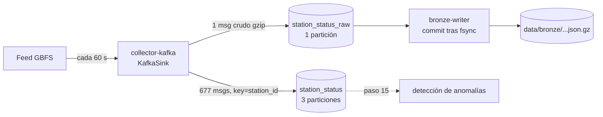

# Kafka en Radar ECOBICI CDMX

Kafka 4.4.0 en modo **KRaft** (un solo nodo que es broker y controller, sin ZooKeeper), perfil
`streaming` de `docker-compose.yml`. Productor: `radar.streaming.producer.KafkaSink`. Consumidor:
`radar.streaming.consumer.BronzeWriter`, grupo `bronze-writer`.



## Diseño de mensajes

| Topic | Particiones | Key | Valor | Para qué |
|---|---|---|---|---|
| `station_status_raw` | 1 | `station_status` | snapshot crudo en gzip (`mtime=0`), headers `last_updated` y `content-encoding: gzip` | que bronze-writer escriba bronze byte a byte igual a lo que respondió el feed |
| `station_status` | 3 | `station_id` | JSON de la estación + `feed_last_updated` + `snapshot_id` | consumidores por estación (anomalías); la key manda cada estación siempre a la misma partición, así que sus mensajes conservan el orden |

**¿Por qué dos topics y no uno?** Bronze necesita el snapshot completo e intacto (D-006: guardar
primero, validar después). Los consumidores analíticos necesitan eventos por estación. Con un
solo topic, uno de los dos tendría que reconstruir lo que el otro ya tenía.

Retención: 7 días (`retention.ms`). Si el consumidor está caído menos de eso, no se pierde nada.

Reparto real de una vuelta (feed en vivo, 2026-11-09): `station_status` particiones 0/1/2 =
219/236/222 mensajes (677 estaciones) y `station_status_raw` = 1.

## Semántica de entrega

- **Productor:** `acks=all` + `enable.idempotence=true`. El broker confirma cada mensaje y los
  reintentos internos del productor no duplican. `write_status` hace `flush(30)` y lanza
  `KafkaDeliveryError` si algún mensaje no se confirmó. Así, un heartbeat `sink=kafka`
  `result=guardado` significa "Kafka ya lo tiene", no solo "lo intenté enviar".
- **Consumidor:** `enable.auto.commit=false`, `auto.offset.reset=earliest`. Por cada mensaje:
  descomprime → escribe bronze (archivo temporal + `fsync` + `os.replace`) → **luego**
  `commit(asynchronous=False)`.
  - Si muere entre escribir y confirmar, al reiniciar relee el mensaje: **at-least-once**.
  - El archivo se llama `station_status_<last_updated>.json.gz` y nunca se sobrescribe, así que
    la segunda escritura es `ya_existia`. El resultado en bronze es efectivamente exactly-once.
  - Si la escritura falla, no hay commit y el mensaje se reintenta.
- **Grupos:**
  - Dos consumidores en el mismo grupo se reparten las particiones.
  - Un consumidor en otro grupo recibe todo otra vez, con sus propios offsets.

## Demo de recuperación

`scripts/demo_recovery.sh` hace lo siguiente:
1. Detiene `bronze-writer` mientras `collector-kafka` sigue publicando.
2. Lo reanuda.
3. Comprueba que cada heartbeat `sink=kafka`, `result=guardado` publicado entre el paro y la
   reanudación tenga su archivo en bronze.

Corrida real con el recolector local ya detenido (bronze-writer es el único escritor), salida
literal:

```text
$ DEMO_PAUSE_SECONDS=120 bash scripts/demo_recovery.sh
inicio=2026-11-09T21:08:47Z · deteniendo bronze-writer por 120 s
reanudando bronze-writer
{"esperados": 2, "encontrados": 0, "faltantes": 2}
{"esperados": 2, "encontrados": 2, "faltantes": 0}
OK: el consumidor recuperó todo lo publicado mientras estuvo apagado
```

La primera línea JSON se toma justo al reanudar: los 2 snapshots publicados durante la pausa
todavía no están en bronze, porque esperan en el topic. Segundos después el consumidor retoma
desde su último offset confirmado y los escribe. Para el post de LinkedIn se corre con
`DEMO_PAUSE_SECONDS=300`.

Nota: el blueprint pedía validar "hasta 90 s antes del fin". Con una pausa de 120 s esa ventana
dejaba solo 30 s y, con un feed que cambia cada ~60 s, a veces 0 snapshots esperados (la prueba
fallaba sin que faltara nada). La ventana se cambió a inicio → reanudación, que es justo lo que
se publicó con el consumidor apagado. El script ya reintenta la verificación hasta 180 s.

## Migración sin huecos

Del recolector local (`collector`, `SINK=local`, paso 3) a Kafka (`collector-kafka` +
`bronze-writer`). Horas reales (UTC):

| Hora | Paso |
|---|---|
| 20:42:46 | Primer snapshot real del recolector local (paso 3) |
| 20:58:58 | `docker compose --profile streaming up -d --wait kafka collector-kafka bronze-writer`, con el recolector local todavía encendido. Ambos escriben el mismo nombre de archivo, así que los duplicados se colapsan (`ya_existia`). |
| 21:01:25 | Revisión: 3 heartbeats `sink=kafka` `guardado`, los 3 con su archivo en bronze, 0 errores |
| 21:03:08 | `docker compose stop collector`. El recolector viejo queda detenido (no se borra), con más de 4 min de convivencia. |
| 21:08:47 | Demo de recuperación con solo Kafka escribiendo: OK |

Comprobación de huecos entre 20:42:46 y 21:10:51: 33 snapshots seguidos en bronze, hueco máximo
de 67 s (la cadencia del propio feed) y ningún hueco mayor a 90 s, ni en la migración ni en las
pausas de la demo.

Cada recolector guarda su estado en `data/state/collector_<sink>.json`, para que durante la
convivencia uno no crea que ya publicó lo que publicó el otro.

Rollback: `docker compose --profile streaming stop collector-kafka bronze-writer` y
`docker compose start collector`.
