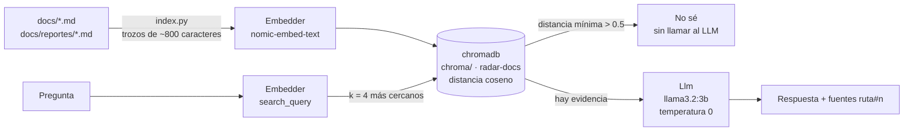

# Asistente RAG (opcional)

Un asistente local que responde preguntas sobre el proyecto usando **solo** la documentación
(`docs/*.md` y `docs/reportes/*.md`) y cita de dónde sacó cada dato. Si no encuentra evidencia,
responde `No sé: no encontré evidencia en la documentación del proyecto.`

Todo corre en la laptop con **Ollama**: costo 0, sin APIs de pago y sin mandar el contenido a
ningún servicio externo.

## Arquitectura



**Patrón Ports & Adapters:** `Embedder` y `Llm` son puertos (interfaces); `OllamaEmbedder`
(`POST /api/embed`) y `OllamaLlm` (`POST /api/chat`) son los adaptadores. Las pruebas usan un
embedder falso (bolsa de palabras con hash) y un LLM falso que cuenta llamadas, con chromadb en
memoria: corren sin red y sin Ollama.

| Pieza | Archivo | Detalle |
|---|---|---|
| Indexador | `src/radar/rag/index.py` | trocea por encabezados (≈ 800 caracteres, 100 de traslape); cada trozo lleva el título de su sección; id `ruta#n`; re-crea la colección en cada corrida |
| Base vectorial | `chroma/` (ignorada por git) | colección `radar-docs`, distancia coseno, `embedding_function=None` (chromadb no descarga su modelo ONNX) |
| Asistente | `src/radar/rag/ask.py` | recupera k = 4 trozos; umbral 0.5; prompt que exige citar `[fuente: ruta#n]` |

**Embeddings:** vectores donde textos con significado parecido quedan cerca. "¿Cada cuánto se
recolecta?" queda cerca de "consulta station_status cada 60 s" aunque no compartan palabras.
`nomic-embed-text` está entrenado con prefijos: el indexador usa `search_document: ` y la
pregunta `search_query: ` (lo hace el adaptador; el puerto no cambia).

**Retriever vs LLM:** el *retriever* (chromadb) solo busca los trozos más parecidos; el LLM solo
redacta con esos trozos. Si el retriever no encuentra nada cercano, el LLM ni se llama.

## Requisitos de RAM

Medido con `ollama ps` en la laptop del proyecto (CPU, sin GPU):

| Modelo | En disco | En memoria al usarse | Contexto |
|---|---|---|---|
| `llama3.2:3b` (respuestas) | 2.0 GB | **2.6 GB** | 4,096 tokens |
| `nomic-embed-text` (embeddings) | 274 MB | **389 MB** | 2,048 tokens |
| **Total** | ≈ 2.3 GB | **≈ 3 GB** | |

Ollama descarga los modelos de la memoria tras 5 minutos sin uso. Con 31.5 GB de RAM sobra
espacio aunque sigan corriendo Kafka, SeaweedFS, Airflow y la API. Tiempos medidos en CPU:
indexar los 16 archivos de `docs/` (176 trozos, incluido este manual) tarda **≈ 80 s**; cada respuesta, **≈ 30–40 s**.

## Cómo usarlo

```bash
ollama pull llama3.2:3b
ollama pull nomic-embed-text
uv run python -m radar.rag.index --json      # {"fragmentos": 176, "archivos": 16}
uv run python -m radar.rag.ask "¿Cada cuánto se recolecta station_status y por qué?"
uv run python -m radar.rag.ask "¿Cuánto superó el modelo al baseline?" --json
```

Vuelve a indexar cada vez que cambie la documentación. Configuración en `.env`: `OLLAMA_URL`,
`OLLAMA_CHAT_MODEL`, `OLLAMA_EMBED_MODEL`. Salida `--json`:
`{"respuesta", "fuentes": ["docs/...#n"], "distancia_min"}`.

Ejemplo real (12 de noviembre de 2026):

> **¿Cada cuánto se recolecta station_status y por qué?** — "Se recolecta `station_status` cada
> 60 s. Esto se debe a que el modelo predice la próxima hora y no necesita resolución de 10 s, lo
> que reduce el volumen de datos…" · fuentes: `docs/bitacora.md#12`, `docs/bitacora.md#13`,
> `docs/arquitectura.md#2`, `docs/kafka.md#2` · distancia mínima 0.20.

## Riesgos y alucinaciones

Un LLM puede **alucinar**: escribir algo que suena bien pero no está en las fuentes. Mitigaciones
del diseño y lo que se observó con datos reales:

| Mitigación | Cómo |
|---|---|
| Contexto obligatorio | el prompt exige responder solo con los trozos recuperados |
| Citas | cada afirmación debe llevar `[fuente: ruta#n]`; la salida trae la lista `fuentes` para verificar |
| Umbral de distancia | si el trozo más cercano está a más de 0.5 (coseno), se responde "No sé" sin llamar al LLM |
| Segunda barrera | si el LLM contesta "No sé", la respuesta se normaliza y no se devuelven fuentes |
| Temperatura 0 | la misma pregunta da la misma respuesta (reproducible para revisar) |

**Lo que pasó en las pruebas reales:**

1. **Alucinación de relleno.** A "¿Cada cuánto se recolecta station_status y por qué?" respondió
   bien lo central (60 s, porque el modelo predice a una hora), pero agregó "60 s es un buen
   equilibrio entre precisión y velocidad", que **no está** en `docs/bitacora.md#12`. El dato es
   correcto; la justificación extra es inventada.
2. **Interpretación errónea.** A "¿Cuánto superó el modelo LightGBM al baseline?" dio el número
   correcto (5.6 % de MAE, `docs/modelo.md#9`) pero lo explicó mal: "hizo 5.6 % menos
   predicciones incorrectas". El MAE mide **cuántas bicis** se equivoca en promedio, no cuántas
   predicciones fallan. Un modelo de 3B parámetros es bueno citando, no razonando.
3. **El umbral de 0.5 no basta solo.** "¿Cuál es la receta del mole poblano?" quedó a distancia
   **0.37** del trozo más cercano (las preguntas del proyecto quedan en 0.18–0.20). Pasó el
   umbral; fue el LLM quien respondió "No sé" y la segunda barrera vació las fuentes. Con
   `nomic-embed-text` un umbral de ≈ 0.3 separaría mejor, pero hace falta calibrarlo con más
   preguntas antes de cambiarlo.

**Reglas de uso:** el asistente es una ayuda para encontrar dónde está la información, no una
fuente de verdad. Siempre abrir la fuente citada antes de usar una respuesta en la exposición o en
un documento. Nunca indexar `data/` ni archivos con datos personales: solo `docs/`.
